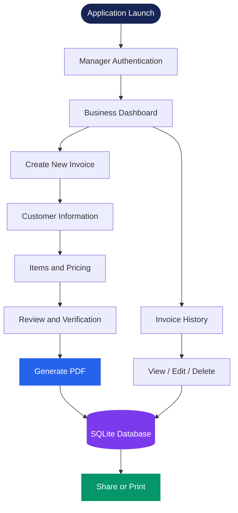

# ⚡ SHREE SHAKTI ELECTRIC

<p align="center">
  
</p>

<p align="center">
  <b>A Premium Billing & Invoice Management Application</b>
  <br/>
  Built to make everyday business operations smarter, faster, and more organized.
</p>

<p align="center">
  <a href="https://github.com/Hemang2601/Bill">
    
  </a>
  
  
</p>

<p align="center">
  
  
  
  
</p>

---

<p align="center">
  
</p>

## 01 — Overview

**Shree Shakti Electric** is a modern, Flutter-powered billing management solution designed to streamline invoice creation, customer billing, document generation, and business record management.

Built around a clean, premium interface and a reliable local database, it transforms traditional billing operations into a simple digital workflow.

The application focuses on three important principles:

<p align="center">
  
  
  
</p>

## 02 — Core Capabilities

<table>
<tr>
<td width="50%" valign="top">

### ◈ Intelligent Dashboard

- Real-time invoice statistics
- Total revenue overview
- Customer insights
- Recent billing activity
- Quick navigation and actions

</td>
<td width="50%" valign="top">

### ◈ Manager Authentication

- Predefined manager accounts
- Persistent login sessions
- Manager-specific signatures
- Controlled application access
- No public registration

</td>
</tr>
<tr>
<td width="50%" valign="top">

### ◈ Smart Invoice Builder

- Three-step invoice workflow
- Customer information management
- Multiple product and service entries
- Automatic calculations
- Invoice review before generation

</td>
<td width="50%" valign="top">

### ◈ Professional PDF Engine

- Structured invoice generation
- Business and customer information
- Itemized billing details
- Authorized manager signatures
- Print and sharing support

</td>
</tr>
<tr>
<td width="50%" valign="top">

### ◈ Billing History

- Search by invoice number
- Customer and mobile search
- Flexible date filters
- Invoice details and PDF access
- Safe deletion operations

</td>
<td width="50%" valign="top">

### ◈ Invoice Editing

- Update existing invoices
- Modify products and quantities
- Automatic total recalculation
- Preserve original invoice identity
- Replace the associated PDF

</td>
</tr>
</table>

## 03 — Application Workflow

<p align="center">
  <b>From customer details to a professionally generated invoice.</b>
</p>



## 04 — Design Philosophy

**A refined interface. A practical experience.**

The application follows a premium white-theme design system with carefully balanced colorful accents.

| Design Element | Direction |
|---|---|
| Primary Theme | Luxury White |
| Primary Color | Electric Blue |
| Secondary Color | Deep Navy |
| Accent Colors | Violet, Emerald, Amber, Coral |
| Interface | Clean and Minimal |
| Components | Modern Cards and Dialogs |
| Interaction | Smooth Micro-animations |
| Layout | Mobile-first and Responsive |

The design prioritizes readability, accessibility, consistency, and usability rather than unnecessary visual complexity.

## 05 — Technology Architecture

<p align="center">
  
</p>

| Layer | Technology | Responsibility |
|---|---|---|
| Frontend | Flutter | Responsive application UI |
| Language | Dart | Application logic |
| Database | SQLite | Persistent local storage |
| Session | SharedPreferences | Login session persistence |
| Documents | PDF | Invoice generation |
| Printing | Printing | Physical invoice printing |
| Sharing | Share Plus | Document sharing |
| Formatting | Intl | Currency and date formatting |

## 06 — Database Structure

**Database:** `shree_shakti.db`

**Schema Version:** `3`

| Table | Purpose |
|---|---|
| `managers` | Authorized manager records |
| `invoices` | Invoice and customer information |
| `invoice_items` | Individual invoice line items |

### Invoice Numbering System

Every invoice follows a structured sequential format:

```text
SE-yyMM-XXX
```

Example:

```text
SE-2611-001
SE-2611-002
SE-2611-003
```

**Data integrity principles:**

- Transaction-based invoice operations.
- Invoice and item records maintained together.
- Existing invoice numbers preserved during editing.
- Foreign key relationships and cascade handling.

## 07 — Project Structure

```text
Bill/
│
├── assets/
│   └── images/
│       ├── hiren.png
│       └── suresh.png
│
├── lib/
│   ├── core/
│   │   ├── theme/
│   │   ├── constants/
│   │   ├── utils/
│   │   ├── widgets/
│   │   └── services/
│   │
│   ├── data/
│   │   ├── database/
│   │   └── models/
│   │
│   ├── features/
│   │   ├── auth/
│   │   ├── dashboard/
│   │   ├── invoice/
│   │   ├── history/
│   │   └── settings/
│   │
│   └── main.dart
│
├── test/
├── pubspec.yaml
└── README.md
```

*High-level representation; actual folders may differ.*

## 08 — Getting Started

### Requirements

- Flutter SDK
- Dart SDK
- Android Studio or Visual Studio Code
- Android SDK
- Git

### Installation

**Step 1 — Clone the repository**

```bash
git clone https://github.com/Hemang2601/Bill.git
```

**Step 2 — Open the project**

```bash
cd Bill
```

**Step 3 — Install dependencies**

```bash
flutter pub get
```

**Step 4 — Verify the development environment**

```bash
flutter doctor
```

**Step 5 — Launch the application**

```bash
flutter run
```

### Development Commands

| Command | Purpose |
|---|---|
| `flutter pub get` | Install dependencies |
| `flutter run` | Run application |
| `flutter test` | Execute automated tests |
| `flutter analyze` | Analyze Dart code |
| `flutter build apk` | Build Android APK |
| `flutter build windows` | Build Windows application |

## 09 — Quality & Testing

<p align="center">
  
  
</p>

The latest reported QA run covered:

- Authentication workflows
- Invoice calculations
- Database operations
- Invoice creation and editing
- Application functionality

*Test results reflect the latest reported run and should be refreshed after subsequent code changes.*

## 10 — Application Preview

<p align="center">
  <b>Experience the interface</b>
  <br/>
  <sub>Real application screenshots will be added here.</sub>
</p>

<!-- Add actual screenshots to the screenshots/ directory. -->

<p align="center">
  
  
  
</p>

<p align="center">
  <sub>Replace these image paths with real screenshots before publishing.</sub>
</p>

## 11 — Security & Data Management

- Local SQLite data persistence.
- Predefined manager authentication.
- Session persistence.
- Manager-specific invoice signatures.
- Transactional invoice updates.
- Confirmation for destructive operations.

> **Security consideration:** The current manager password implementation has not yet been migrated to a dedicated slow password-hashing algorithm. Further security hardening is recommended before production deployment.

## 12 — Platform Compatibility

| Platform | Availability |
|---|---|
| Android | Primary development platform |
| Windows | Build setup in progress |
| iOS | Not verified |
| Web | Not verified |

## 13 — Roadmap

- [ ] Enhanced password security
- [ ] Database backup and restoration
- [ ] Advanced sales analytics
- [ ] Detailed financial reports
- [ ] Additional business configuration
- [ ] Improved deployment and release workflow

## 14 — Developer

<p align="center">
  
</p>

<p align="center">
  <a href="https://github.com/Hemang2601">
    
  </a>
  <a href="https://github.com/Hemang2601/Bill">
    
  </a>
</p>

## 15 — License & Ownership

Developed for **Shree Shakti Electric**.

All rights reserved unless a separate license is explicitly provided in this repository.

---

<p align="center">
  
</p>

<p align="center">
  <b>SMART BILLING · SIMPLE MANAGEMENT · PROFESSIONAL INVOICES</b>
  <br/>
  <sub>Designed with purpose. Built with Flutter. ⚡</sub>
</p>
