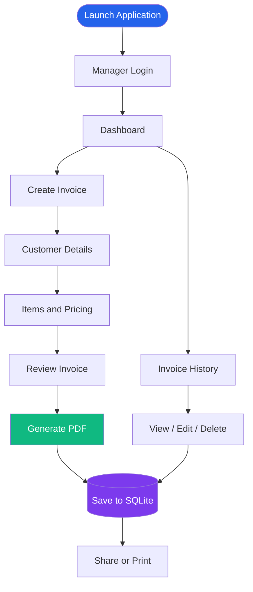

# ⚡ Shree Shakti Electric

<h3 align="center">Premium Billing Management Application</h3>

<p align="center">
  
</p>

<p align="center">
  A modern, responsive, and feature-rich billing application designed to simplify everyday business operations for Shree Shakti Electric.
</p>

<p align="center">
  
  
  
  
</p>

<p align="center">
  <a href="https://github.com/Hemang2601/Bill">
    
  </a>
  
  
</p>

---

## ✨ About the Project

**Shree Shakti Electric** is a modern billing management application developed using Flutter and Dart.

It helps manage invoices, customer information, billing history, and PDF documents through a simple and professional interface.

Designed with a premium white theme, colorful accents, and responsive layouts, the application provides a smooth experience across mobile devices and larger screens.

## 🚀 Features

<table>
<tr>
<td width="50%">
<h3>🔐 Manager Authentication</h3>
<ul>
<li>Predefined manager accounts</li>
<li>Session persistence</li>
<li>Manager-specific signatures</li>
<li>No public registration</li>
</ul>
</td>
<td width="50%">
<h3>📊 Smart Dashboard</h3>
<ul>
<li>Total invoice statistics</li>
<li>Revenue overview</li>
<li>Customer statistics</li>
<li>Recent invoice activity</li>
</ul>
</td>
</tr>
<tr>
<td width="50%">
<h3>🧾 Invoice Management</h3>
<ul>
<li>Three-step invoice workflow</li>
<li>Customer information</li>
<li>Multiple invoice items</li>
<li>Automatic calculations</li>
</ul>
</td>
<td width="50%">
<h3>📄 PDF Generation</h3>
<ul>
<li>Professional invoice PDFs</li>
<li>Manager signatures</li>
<li>Print and share support</li>
<li>Preserved invoice layout</li>
</ul>
</td>
</tr>
<tr>
<td width="50%">
<h3>📚 Billing History</h3>
<ul>
<li>Search and date filters</li>
<li>View invoice details</li>
<li>Share and print invoices</li>
<li>Safe invoice deletion</li>
</ul>
</td>
<td width="50%">
<h3>✏️ Edit Invoices</h3>
<ul>
<li>Update customer details</li>
<li>Modify invoice items</li>
<li>Automatic recalculation</li>
<li>Preserve existing bill number</li>
</ul>
</td>
</tr>
</table>

## 🎨 Application Design

<p align="center">
  <strong>Luxury White Theme · Colorful Accents · Responsive Interface</strong>
</p>

The application follows a consistent design system featuring:

- Clean white surfaces and soft neutral backgrounds.
- Electric blue and navy primary colors.
- Balanced violet, emerald, amber, and coral accents.
- Premium cards, modern typography, and subtle shadows.
- Smooth transitions and interactive feedback.
- Mobile-first layouts with desktop responsiveness.

## 🔄 How It Works



## 🛠️ Technology Stack

<p align="center">
  
</p>

| Technology | Usage |
|---|---|
| Flutter | Cross-platform UI |
| Dart | Application development |
| SQLite | Local database |
| SharedPreferences | Session persistence |
| PDF | Invoice generation |
| Printing | Print invoices |
| Share Plus | Share documents |
| Intl | Currency and date formatting |

## 🗂️ Project Structure

```text
Bill/
│
├── assets/
│   └── images/
│       ├── hiren.png
│       └── suresh.png
│
├── lib/
│   ├── core/
│   │   ├── theme/
│   │   ├── constants/
│   │   ├── utils/
│   │   ├── widgets/
│   │   └── services/
│   │
│   ├── data/
│   │   ├── database/
│   │   └── models/
│   │
│   ├── features/
│   │   ├── auth/
│   │   ├── dashboard/
│   │   ├── invoice/
│   │   ├── history/
│   │   └── settings/
│   │
│   └── main.dart
│
├── test/
├── pubspec.yaml
└── README.md
```

*The structure above is a high-level overview. Refer to the repository for the actual implementation.*

## 🗄️ Database Design

Database: `shree_shakti.db`

Schema Version: `3`

| Table | Responsibility |
|---|---|
| `managers` | Authorized manager records |
| `invoices` | Invoice and customer details |
| `invoice_items` | Individual invoice items |

### Automatic Invoice Numbering

```text
SE-yyMM-XXX

SE-2611-001
SE-2611-002
SE-2611-003
```

Invoices use sequential numbering and transactional database operations.

## ⚙️ Installation & Setup

### Prerequisites

- Flutter SDK
- Dart SDK
- Android Studio or VS Code
- Android SDK
- Git

### Clone Repository

```bash
git clone https://github.com/Hemang2601/Bill.git
```

### Open Project

```bash
cd Bill
```

### Install Dependencies

```bash
flutter pub get
```

### Check Environment

```bash
flutter doctor
```

### Run Application

```bash
flutter run
```

### Run Tests

```bash
flutter test
```

### Analyze Code

```bash
flutter analyze
```

## 🧪 Quality Assurance

Latest reported project QA results:

<p align="center">
  
  
</p>

- Invoice calculation tests.
- Database operation tests.
- Authentication workflow tests.
- Invoice creation and editing tests.
- Application workflow validation.

*These results reflect the latest reported QA run and should be updated after future test runs.*

## 📸 Screenshots

<p align="center">
  <i>Application screenshots will be added here.</i>
</p>

<!--
Add your actual screenshots to a GitHub screenshots/ folder
and replace the placeholders below.

<p align="center">
  
  
  
</p>
-->

## 🔒 Data & Security

- Local SQLite database storage.
- Predefined manager authentication.
- Persistent login sessions.
- Manager-specific invoice signatures.
- Transaction-based invoice operations.
- Confirmation before destructive operations.

**Security note:** The current manager password implementation has not yet been migrated to a dedicated slow password-hashing algorithm. Additional security hardening is recommended before production deployment.

## 🖥️ Platform Support

| Platform | Status |
|---|---|
| Android | Primary platform |
| Windows | Development/build setup in progress |
| iOS | Not verified |
| Web | Not verified |

## 🗺️ Future Improvements

- Advanced sales analytics.
- Database backup and restore.
- Invoice export and reporting.
- Enhanced authentication security.
- Additional business configuration options.

## 👨‍💻 Developer

<p align="center">
  <strong>Hemang Lakhadiya</strong><br/>
  MCA Student · Flutter Developer · Full Stack Developer
  <br/><br/>
  <a href="https://github.com/Hemang2601">
    
  </a>
</p>

## 📄 License

Developed for **Shree Shakti Electric**. All rights reserved unless a separate license is provided in this repository.

---

<p align="center">
  
</p>

<p align="center">
  <strong>⚡ SHREE SHAKTI ELECTRIC</strong><br/>
  <sub>Smart Billing. Simple Management. Professional Invoices.</sub>
</p>
